# A7 – FEA on bracket

## Objective
The objective of this assignment was to do a finite element analysis on the bracket design in order to optimize it (to a certain point, 100% optimization is unnecessary and more time-consuming). After each iteration of FEA, the bracket is to be redesigned to ensure the stress, displacement, and safety factor converge on a 7 percent difference. Due to the new program applied to select few, 2157 students get the joy of doing an FEA not only for the bracket, but also the link. This is thrilling and worth the extra credit hour (no its not).

## FEA analysis for bracket
The first step to setting up the FEA analysis is to ensure it reflects the applied load and fixtures from A5 and A6. An applied load downward of 600 to the shaft and fixtures where the T-beam would fit had to be added to be able to run the FEA, And so I did exactly that. 

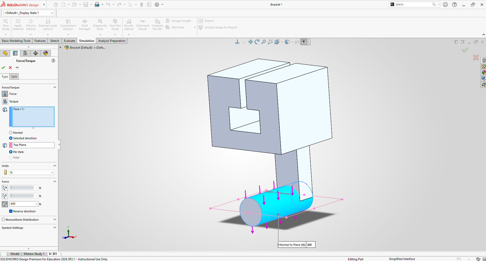
 
 
The bracket and link are made of 6061-T6 aluminum alloy, and so the yield strength of the material is 39885.32 psi and a modulus of elasticity of 10007604 psi. The given maximum limiting deflection is .005 inches and instructed safety factor is four.
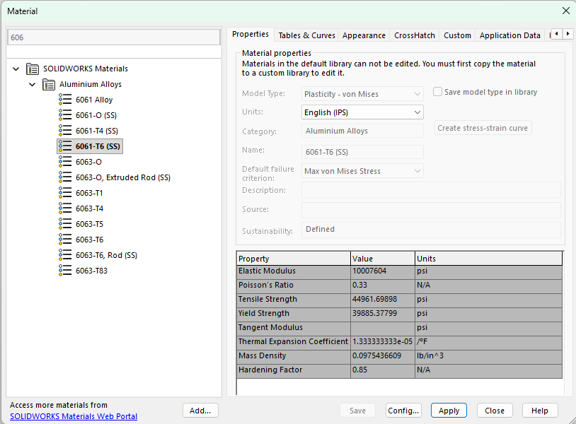

### Design 1 (Original)

#### Mesh #1
I then created the first mesh for the model, which has total elements of 2844. With this the FEA can run and give the brackets behavior with values for stress, deflection, and safety factor. From the von mises curve, the chart shows the brackets minimum stress of 1.887e-10 psi and a maximum stress located at the strap connecting the shaft and bracket to be 7.504e2 psi. The deflection chart shows its concentrated the end of the shaft, with a maximum of 2.285e-3 inches. The factor of safety plot gives a large red bracket with a maximum of 5.315. The initial mass of the model is 12.52 pounds as well.
 
 
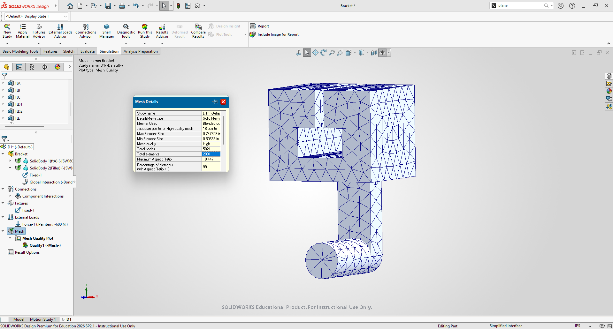
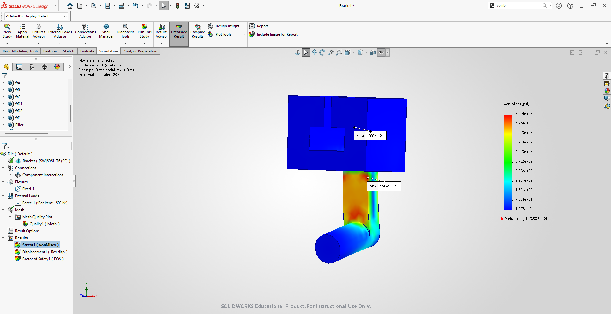
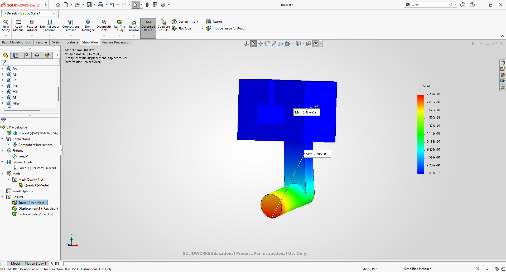
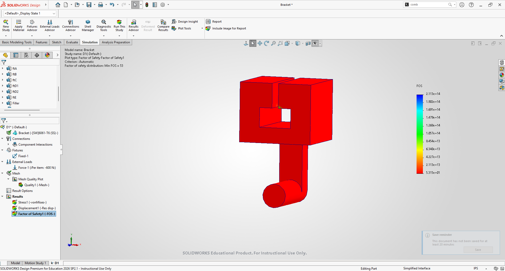
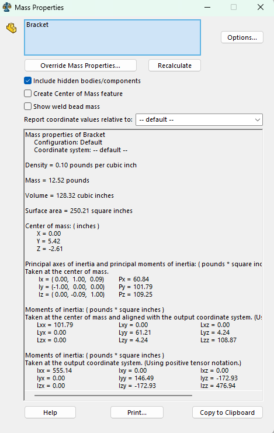

#### Mesh #2
To be able to test for convergence, the mesh had to be modified and have its stress, displacement, and safety factor compared to the previous mesh. I changed the mesh and increased the number of elements to 4760. The new values were a max stress of 8.129e2 psi, displacement of .002302 inches, and safety factor of 4.907. convergence is found by finding the percent difference between the values of the first mesh to the second mesh. calculating the convergence gives a percent difference of 7.99% for stress, 21.27% for displacement, and 12.54% for the safety factor. another mesh must be made to converge to 7% or lower. the mass of the design will remain unchanged until the first redesign.
 
 
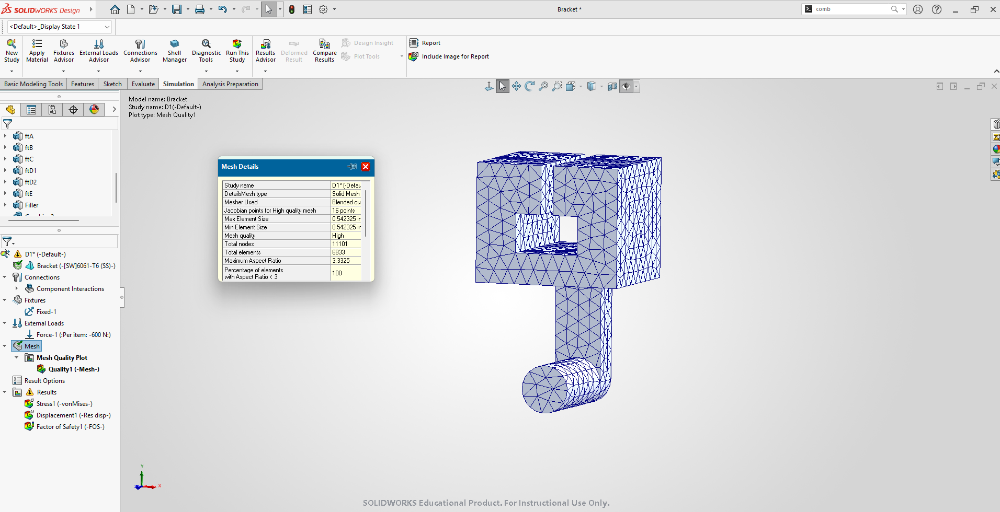
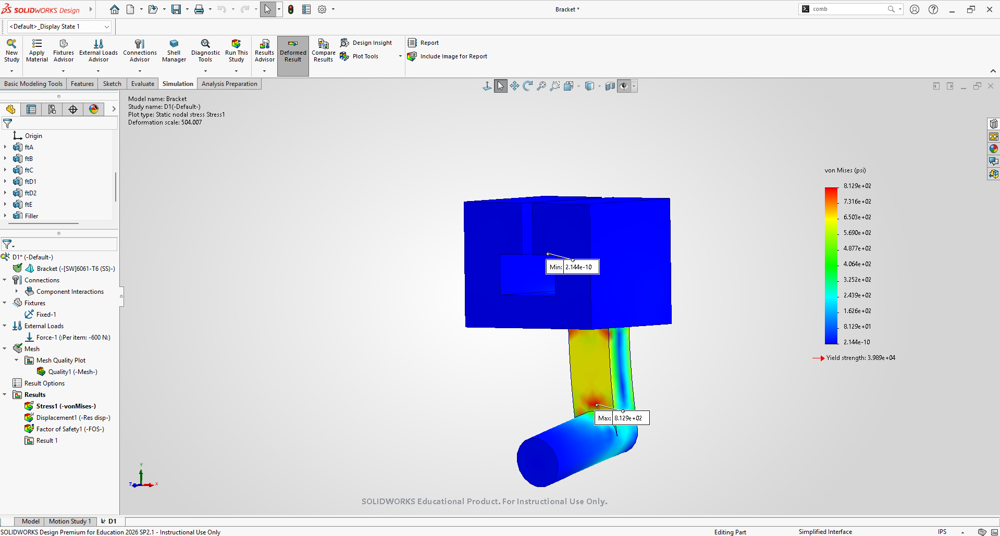
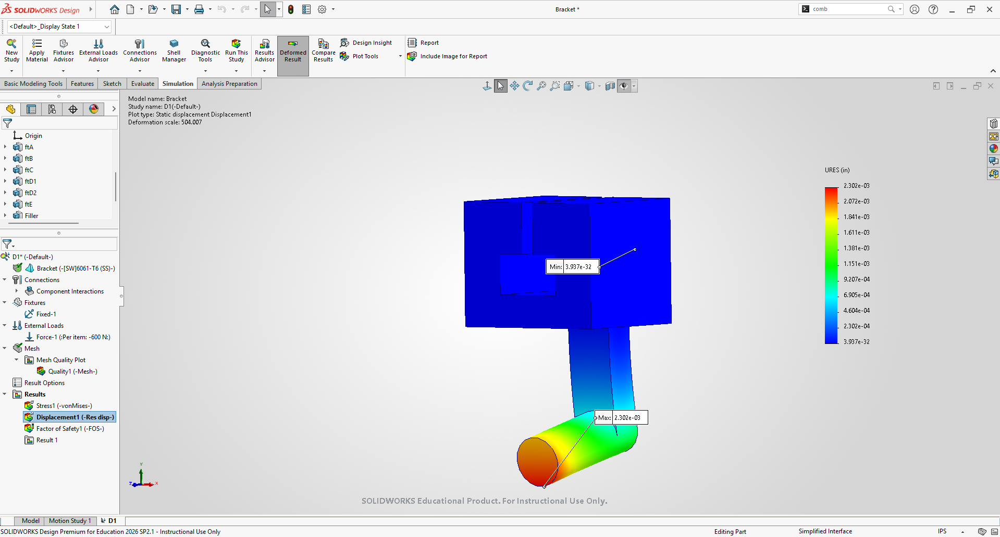

#### Mesh #3
The next mesh had a total elements of 14931. the corresponding values were a max stress felt of 914 psi, displacement of .002324 inches, and a safety factor of 4.364. The found convergence/percent differences for stress was calculated to be 11.7%, displacement convergence of 0.95%, and safety factor of 11.71%. Another mesh must be created to attempt to achieve convergence for all three.
 
 
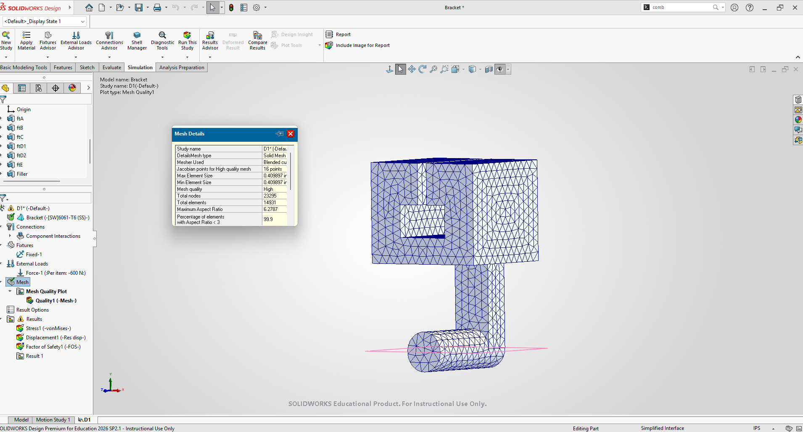

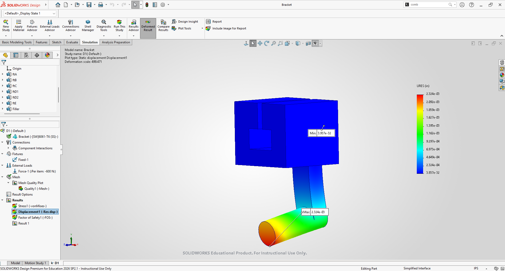

#### Mesh #4
For the final mesh, I bumped the scale near to fine, and got a total number of elements of 41333. The new values were a stress of 1092 psi, displacement of .002338 inches, and a safety factor of 3.652. the final convergence for values were a stress convergence of 17.74%, displacement convergence of 1.03%, and safety factor 17.76%. The amount of convergences is limited to three. Because stress and the safety factor hasnt converge to seven percent. another mesh must be created to the max amount of elements possible.
 
 
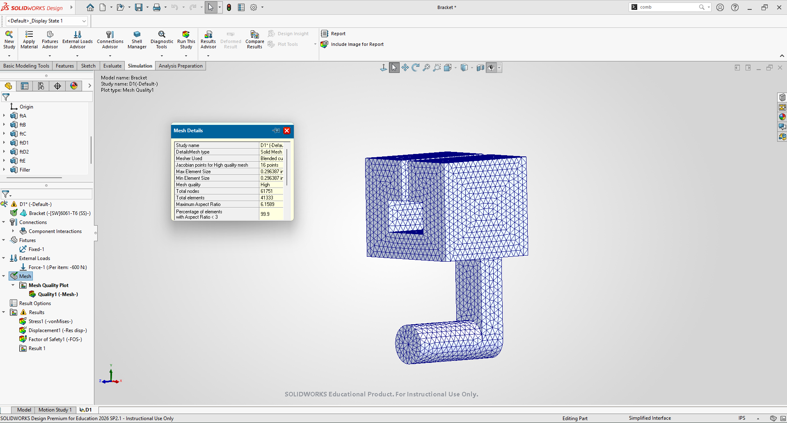
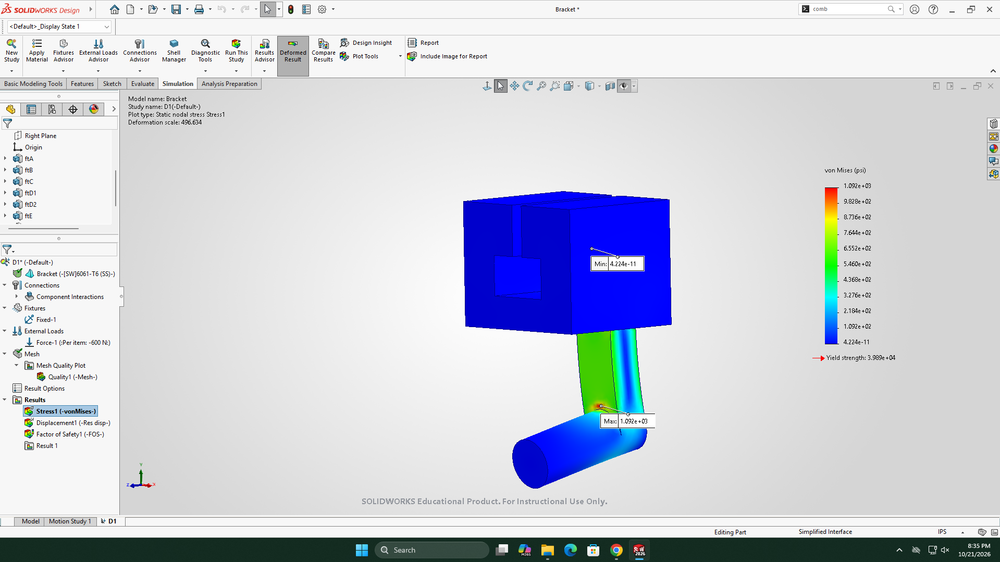

#### Mesh #5
The max amount of total elements is 63038, when shifted to the farthest right, going from coarse to fine. the new values are a stress of 1096 psi, displacement of .002344, and safety factor of 3.64. The calculated convergence were .36% for stress, .25% for displacement, and 0.32% for safety factor. The bracket can now be redesigned, and the calculations for all the convergences were done on paper and below with the solidworks screenshots.
 
 
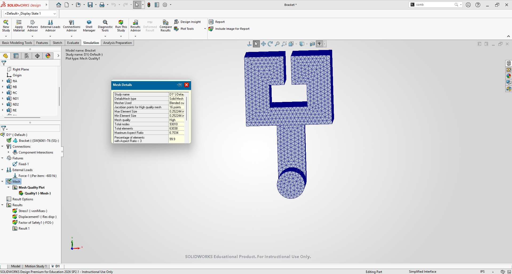
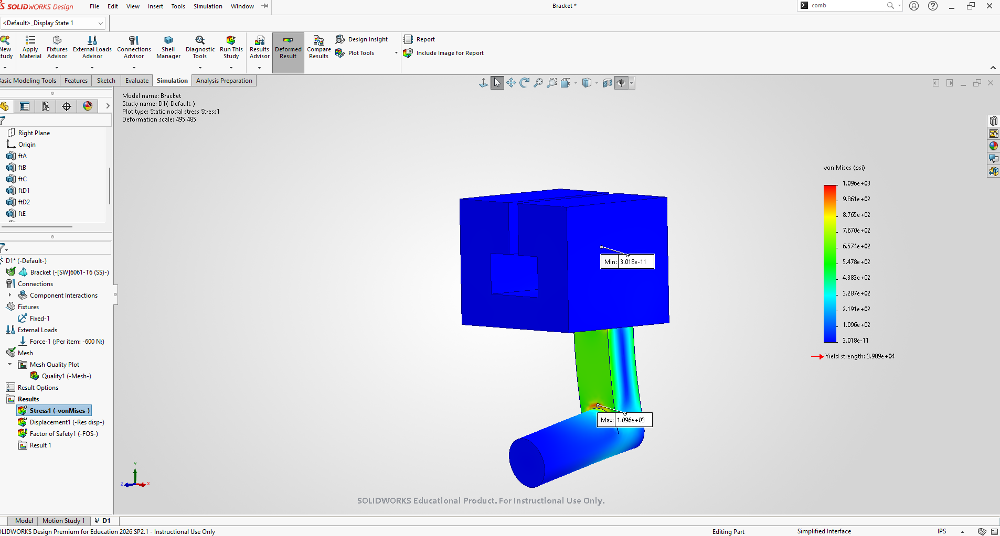
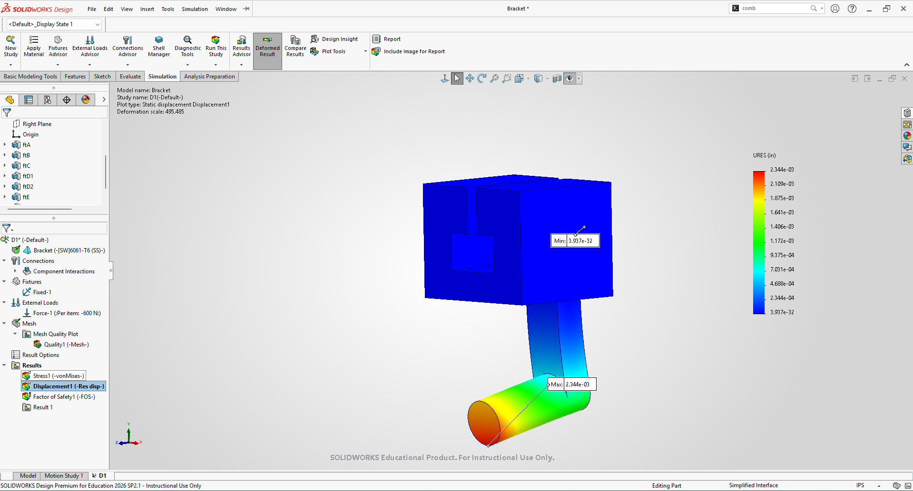
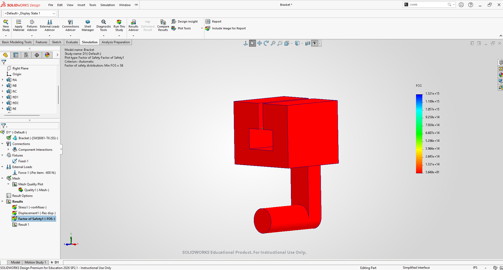

### Design 2
For the first redesign of the bracket, I added another Feature B (refer to A5) in middle of the shaft,2.5 inches, by adding a plane on the face of the shaft and then offsetting the plane to 2.5 inches in the reverse direction. To keep the height of the feature the same, I extruded both directions and parametrically modeled it for both directions to "htfb"/2, which is 0.63 inches. This way the stress concentration wont as a large now that there two, and that the link can still attach onto the shaft. With the added feature, the new weight of the bracket is 13.25 pounds as well.. A new FEA can be now be FEA'd for the bracket.
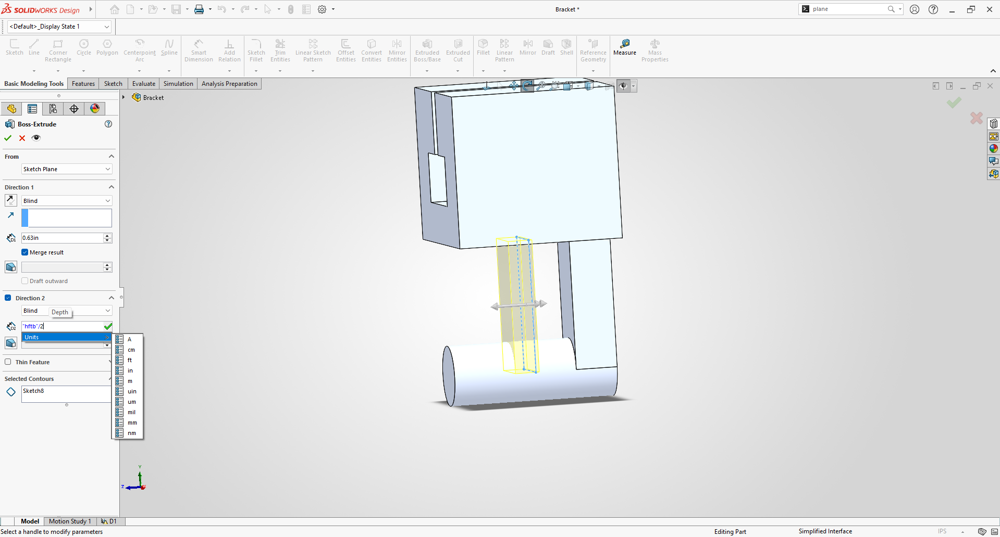
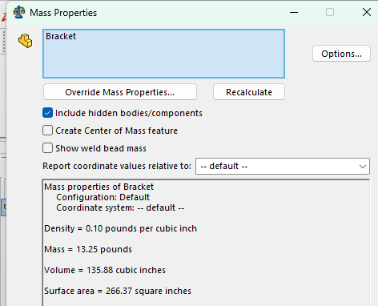

 
 
 
#### Mesh #1
This time I made sure to make the initial mesh element count higher. The element count for mesh 1 was 8515. The corresponding max values were a max stress of 165.6 psi, displacement of .0001317 inches, and a safety factor of 240.9. No convergence is needed yet that these would be the initial values, and the proceeding mesh hold the final values in the equation.

#### Mesh #2
The next mesh had a total element number of 24727. with those elements the new values were a max stress of 185.5 psi, max displacement of .0001327 inches, and a max safety factor of 215.1. Convergence can now be found; the covergence for stress was 11%, the percent difference for displacement was 0.75%, and the percent difference for factor of safety was 11.315%

#### Mesh #3
The following mesh I created had a total number of 30000 elements. I kept it fairly close to mesh #2 so that the difference between the two wouldn't be considerably large. The max stress was 190.6 psi, the max deflection was .0001328 inches, and the safety factor was 209.3. The convergence between the three were below 7%, with stress equated to 2.717%, deflection off .075%, and the safety factor off 2.733%. With all three parametrs meeting convergence, The bracket can be designed again.
## Decide

## Communicate

